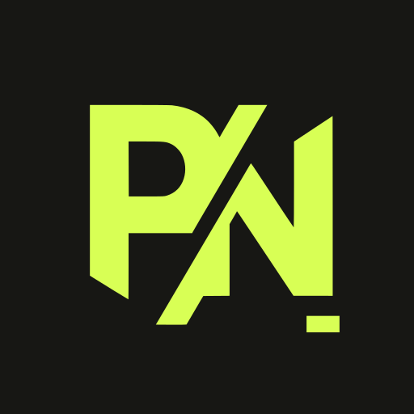

# PdfCraft app icon



**Mark:** Philipp Niestroj's PN mark (`docs/brand/pn-mark-lime.svg`), unmodified, centred at 380/512.

**Style:** the corporate identity of [philippniestroj.com](https://philippniestroj.com): a full-bleed
ink field, square corners, the mark in acid lime.

**Palette:** exactly two colours.

| Colour | Hex | Used for |
|---|---|---|
| Ink | `#171714` | the full-bleed field |
| Acid lime | `#d8ff55` | the PN mark |

The Windows PDF file icon uses the same identity: a paper (`#f1efe8`) document with ink line work and
an ink PDF badge with lime lettering.

**Tile:** `viewBox="0 0 512 512"`, a square (no corner radius, like the website's `--radius: 0`).
Windows and Linux icons use the full-bleed tile. macOS icons put it on Apple's grid (an 824 px body
centred on a transparent 1024 px canvas).

**Provenance:** Philipp Niestroj's own mark from his brand assets. Licence:
[LICENSE.txt](LICENSE.txt) (`MIT OR Apache-2.0` for the artwork; the PN mark itself is a trademark,
see `docs/brand/LICENSE-brand.txt`).

## Files

| File | What it is |
|---|---|
| `pdfcraft.svg` | the master vector; every PNG, `.ico` and `.icns` is rendered from it |
| `pdfcraft-small.svg` | a copy of the master for places that link a small vector, such as this README |
| `pdfcraft-1024.png` | 1024 px on Apple's grid; also the runtime Dock icon on macOS |
| `pdfcraft.icns` | macOS icon (16–1024 px) |
| `pdfcraft.ico` | Windows icon (16–256 px), embedded in `pdfcraft.exe` by `apps/pdfcraft/build.rs` |
| `pdfcraft-document.svg` | Windows PDF file icon master: a Lucide document outline, ink badge and outlined lime PDF lettering; no font dependency |
| `pdfcraft-document.ico` | Windows PDF file icon (16–256 px), embedded as resource 2 in `pdfcraft.exe` |
| `hicolor/<n>x<n>/apps/com.philippniestroj.pdfcraft.png` | Linux hicolor theme, 16–512 px; the 256 px one is the runtime icon on Windows and Linux |
| `hicolor/scalable/apps/com.philippniestroj.pdfcraft.svg` | Linux scalable icon (copy of the master) |

Where it shows: `apps/pdfcraft/src/main.rs` sets the window icon (Dock, taskbar, Alt-Tab, launcher) and the
Wayland app id `com.philippniestroj.pdfcraft`; `packaging/linux/com.philippniestroj.pdfcraft.desktop` names the
hicolor icon.

Windows PDF files use resource 2 (`"pdfcraft.exe",-2`) when PdfCraft is chosen as the default
reader; the app keeps resource 1. The document outline is adapted from Lucide `file-text`
1.49.0 (ISC); its badge and outlined lettering are original (`MIT OR Apache-2.0`), covered by
[LICENSE-document.txt](LICENSE-document.txt). Both icons are embedded, requiring no runtime
sidecar. This provides a file type icon; first-page thumbnails still need a thumbnail provider.

## Regenerate

```sh
packaging/icons.sh        # needs resvg and python3 (iconutil on macOS is used for the .icns when present)
cargo xtask assets        # then update the sha256 values in ATTRIBUTION.toml and run with --write
```
